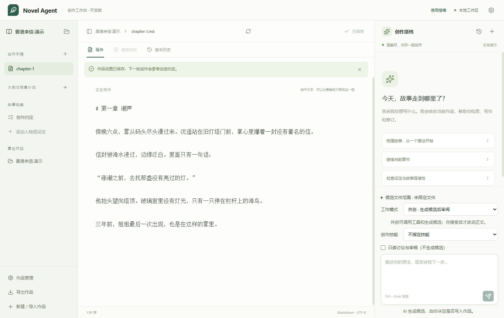
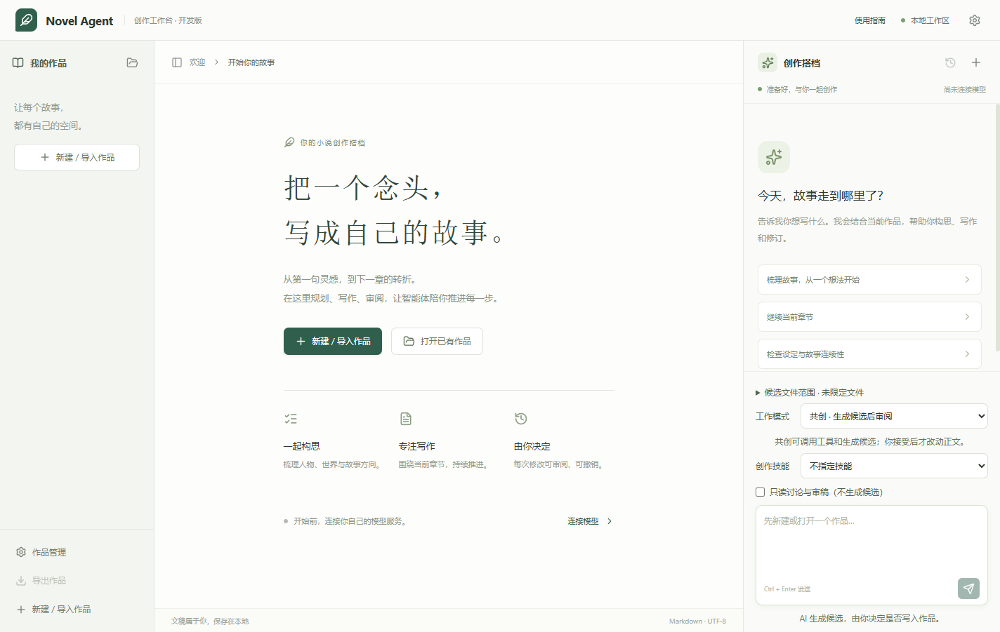
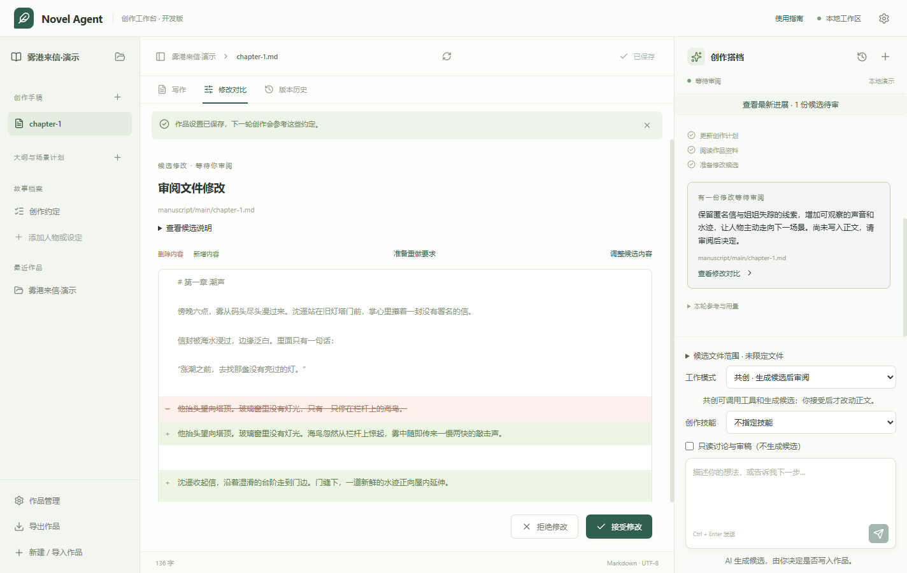

# Novel Agent

**简体中文** · [English](README.en.md) · [日本語](README.ja.md) · [한국어](README.ko.md)

本地优先的小说创作智能体桌面客户端。围绕作品资料与正文开展多轮讨论、规划、写作和审稿，把模型生成的修改交给作者审阅后再写入正式文件。

当前为 **0.2.1 早期版本**，提供 Windows x64 免安装运行版和源码。客户端界面和详细文档以简体中文为主；本页提供四种语言。

## 直接下载运行（无需源码）

**只想使用程序？前往 [最新版本下载](https://github.com/HisenL/novel-agent/releases/latest)，在 Assets 中下载程序，不要下载 Source code。**

1. 推荐下载 [Windows x64 免安装 EXE](https://github.com/HisenL/novel-agent/releases/download/v0.2.1/Novel-Agent-0.2.1-windows-x64.exe)，双击即可启动，无需安装 Node.js、pnpm 或 Git，也无需管理员权限。
2. 备用：[Windows x64 ZIP](https://github.com/HisenL/novel-agent/releases/download/v0.2.1/Novel-Agent-0.2.1-windows-x64.zip)。**完整解压**后双击 `Novel Agent.exe`；不要只复制 EXE，不要在压缩包里运行。
3. 在客户端配置自己的模型服务并测试连接，再新建或打开作品。程序不附带 API Key 或本地大模型；在线创作仍需网络，模型调用可能收费。

模型设置保存在 `%APPDATA%\Novel Agent`，正文和任务历史保存在你选择的作品文件夹。升级时保存并关闭旧版，下载新版再运行，不删除设置或作品。源码版设置不会自动迁移，请重新配置模型后打开原作品。

本版尚未代码签名，Windows 可能提示未知发布者。只从本仓库 Releases 下载，可对照同页 `SHA256SUMS.txt` 校验完整性；不要关闭系统安全防护。详见[版本说明](docs/releases/0.2.1.md)。

## 界面预览

作品目录、Markdown 写作台与创作搭档并排呈现，方便边写边讨论。



<details>
<summary>查看欢迎页与修改审阅</summary>

欢迎页：新建或打开作品，从构思、写作与审阅开始。



修改审阅：查看正文差异与执行进度，接受后才写入作品。



</details>

截图来自 Windows 客户端，作品内容为虚构演示；审阅示例使用本地模拟模型，不代表特定模型的生成质量。

## 功能

- 创建、打开和导入本地作品，使用 Markdown 编辑正文、YAML 保存创作约定。
- 维护大纲、场景计划、人物、地点、时间线和伏笔文档。
- 智能体按任务调用读取、检索、规划和候选生成工具，显示执行过程。
- 探索模式只读讨论；共创模式生成候选；批量模式限定候选文件范围。
- 内置场景规划、对白润色和连续性审稿技能，可查看采用的规则。
- 对比、接受、拒绝、调整或按意见重做候选；支持选区和精确原文替换。
- 保存不可变修订历史，以反向候选撤销修改，检查外部编辑冲突。
- 保存会话与待审候选，重开后查看进度并手动继续任务。
- 预览后复制导入 Markdown/YAML 文件夹，导出已保存内容为 ZIP。

## 从源码运行

准备 Git、Node.js 22 或更新版本，以及 pnpm 11.8.0。在项目根目录运行：

```powershell
pnpm install --frozen-lockfile
pnpm desktop:prepare
pnpm desktop:build
pnpm desktop:start
```

若安装依赖时 Electron 运行文件未下载，先运行 `node apps/desktop/node_modules/electron/install.js`，再继续准备和构建。

`pnpm desktop:start` 使用已准备好的本地构建，不会在每次启动时重新下载依赖。普通作者请使用上方的免安装下载入口。

## 开始创作

1. 在“模型设置”填写服务地址、接口协议、模型名和 API Key，保存并测试连接。
2. 点击“新建 / 导入作品”选择作品文件夹，在“作品管理”中填写创作约定。
3. 在右侧描述任务，例如“读取约定和当前章节，先列场景计划，再生成开场候选”。
4. 查看执行过程和差异，接受合适的候选，或拒绝并提出修改意见。

模型服务需支持函数工具调用，接口协议必须明确选择 Responses 或 Chat Completions。不同端点与模型的兼容性以连接检测和实际工具调用为准。软件不会自动切换到演示模型。

## 内容、密钥与费用

- 正文、设定、会话和候选保存在本机。使用外部模型时，相关作品内容会发送到你配置的服务，遵循该服务的数据处理政策。
- API Key 通过 Electron 的系统安全存储加密保存。请勿把密钥写入作品、对话或公开问题报告。
- 测试连接、创作和继续任务可能收费。支持每轮调用上限、Token 用量和可选的单价估算；费用未知不代表免费。
- 断线后不会自动重发模型请求。失败或中断的请求也可能已经计费。

## 当前限制

- 免安装程序目前仅支持 Windows x64，尚未代码签名；macOS/Linux 桌面端未完成同等程度验证。
- 未保存的正文不保证在崩溃后恢复，请及时保存并备份作品文件夹。
- ZIP 仅含已保存正文与设定，不含任务账本、待审候选或密钥，不能代替完整备份。
- 导入限制为最多 8 层目录、2,000 个扫描条目、50 个候选文件，每个文件不超过 1 MiB。
- 上下文和检索有范围上限，尚无长篇分层记忆；审稿和生成结果需要作者核对。
- 尚不提供 DOCX/EPUB、云同步、社区可执行插件或一键整本定稿。

## 文档与贡献

- [用户指南](docs/user-guide.md)
- [开发与验证](docs/development.md)
- [架构](docs/architecture.md) · [协议与数据](docs/protocol.md)
- [贡献指南](CONTRIBUTING.md) · [安全政策](SECURITY.md)
- [更新记录](CHANGELOG.md)

欢迎提交问题和改进建议。报告问题时请附操作步骤、版本和错误文字，并移除密钥与个人稿件。

## 许可证

[Apache-2.0](LICENSE)。版权声明见 [NOTICE](NOTICE)。
